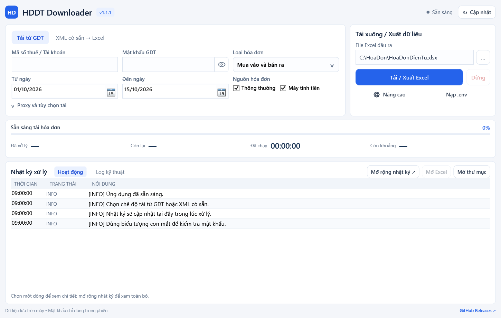

# HDDT Downloader

Công cụ PowerShell tải **XML hóa đơn điện tử** từ hệ thống GDT
(`hoadondientu.gdt.gov.vn`) và xuất ra workbook `.xlsx` theo đúng bố cục
sheet/cột của bản gốc `TaiHoaDonDienTu`.

- Tải hóa đơn **mua vào** và **bán ra**; tự lấy CAPTCHA và đăng nhập GDT.
- Xuất Excel dạng dữ liệu (không VBA, không sheet `MENU`) đúng bố cục bản gốc.
- Có app Windows một file EXE, và CLI dùng `.env` hoặc nhập trực tiếp.
- Hỗ trợ proxy/VPN khi IP hiện tại bị GDT hạn chế; chuyển XML có sẵn sang Excel offline.

| Hạng mục | Nội dung |
|---|---|
| Phiên bản | v1.1.1 |
| App Windows | Một file EXE, nhấn đúp là chạy (Windows 10/11) |
| CLI | Windows PowerShell 5.1, PowerShell 7 trên Windows/macOS/Linux |
| Không cần cài | Excel, Node.js, PowerShell 7 (khi dùng EXE), thư viện ngoài |
| Không chứa | VBA, sheet `MENU`, dữ liệu hóa đơn hoặc tài khoản trong gói phát hành |



📺 [Video hướng dẫn sử dụng](https://www.youtube.com/watch?v=nLWvosy-IM0)

## Mục lục

1. [Bắt đầu nhanh trên Windows](#1-bắt-đầu-nhanh-trên-windows)
2. [App EXE: dữ liệu, cấu hình, cập nhật](#2-app-exe-dữ-liệu-cấu-hình-cập-nhật)
3. [Kết quả Excel](#3-kết-quả-excel)
4. [Cấu hình `.env`](#4-cấu-hình-env)
5. [Proxy](#5-proxy)
6. [Chuyển XML có sẵn sang Excel](#6-chuyển-xml-có-sẵn-sang-excel)
7. [Linux / macOS](#7-linux--macos)
8. [Cơ chế tải XML và xử lý lỗi](#8-cơ-chế-tải-xml-và-xử-lý-lỗi)
9. [Build và phát hành](#9-build-và-phát-hành)
10. [Kiểm thử](#10-kiểm-thử)
11. [Bảo mật](#11-bảo-mật)
12. [Đóng góp](#12-đóng-góp)

---

## 1. Bắt đầu nhanh trên Windows

### Cách A — App có giao diện (khuyến nghị)

1. Tải `HDDT-Downloader-v1.1.1-windows.exe` tại
   [GitHub Releases](https://github.com/dieutx/hddt-downloader-windows/releases).
2. Nhấn đúp file EXE. Không cần tự giải nén, cài đặt hay cài PowerShell 7;
   app dùng Windows PowerShell 5.1 và .NET Framework có sẵn.
3. Nhập mã số thuế + mật khẩu GDT, chọn khoảng ngày và chiều hóa đơn, rồi bấm
   **Bắt đầu**.

Giao diện compact: header nhỏ, form hóa đơn và điều khiển tải hai cột, tiến độ
và nhật ký luôn nhìn thấy — không phải cuộn toàn trang ở 1160×768, 1366×768,
1440×900 hay 1920×1080. Nhật ký chính hiện 4–6 dòng gần nhất, **Mở rộng nhật
ký** xem toàn bộ trong cửa sổ riêng, nút con mắt để hiện/ẩn mật khẩu. Proxy mở
trong panel nhỏ; chuyển tab giữ nguyên dữ liệu đã nhập.

- Tab **Tải từ GDT**: tải hóa đơn mua vào/bán ra rồi tạo Excel.
- Tab **XML có sẵn → Excel**: chuyển thư mục XML offline, không cần Internet.
- **Dừng an toàn** chờ request hiện tại và xuất phần dữ liệu đã xử lý. Đóng cửa
  sổ khi đang chạy cũng yêu cầu dừng an toàn.
- **Nạp cấu hình .env** dùng cấu hình có sẵn, không sửa file `.env`.
- **Cài đặt nâng cao**: số kết nối XML ban đầu/tối đa, giãn cách request, thời
  gian phục hồi sau 429, giãn cách API danh sách, retry, timeout, số hóa đơn
  mỗi trang, tự điều tiết danh sách và ghi nhật ký. Tham số được kiểm tra trước
  khi áp dụng; có nút khôi phục mặc định.
- Bật **Ghi nhớ cho lần mở app sau** để lưu tham số vào `hddt-settings.json`;
  nạp `.env` sau đó sẽ ưu tiên giá trị trong `.env` cho phiên hiện tại.
- Giao diện luôn từ chối ghi đè Excel đã có, kể cả khi `.env` đặt
  `OVERWRITE_OUTPUT=true`; tên đầu ra mặc định kèm thời điểm chạy.

App dùng WPF/.NET Framework, chỉ chạy trên Windows. Các lệnh CLI bên dưới vẫn
dùng được trên Windows, macOS và Linux.

### Cách B — CLI với `.env`

```bat
git clone https://github.com/dieutx/hddt-downloader-windows.git
cd hddt-downloader-windows
copy .env.example .env
```

Mở `.env`, điền các giá trị cần thiết (4 dòng đầu là bắt buộc):

```dotenv
GDT_USERNAME=0123456789
GDT_PASSWORD=mat_khau
FROM_DATE=31/12/2025
TO_DATE=01/01/2026
INVOICE_DIRECTION=both
```

Rồi nhấn đúp `run.cmd`. Chương trình tự lấy CAPTCHA, đăng nhập, tải danh sách
hóa đơn, tải XML và tạo Excel.

Không muốn sửa `.env`? Chạy `run-interactive.cmd` để nhập trực tiếp tài khoản,
mật khẩu (chế độ bí mật), khoảng ngày, chiều hóa đơn, thư mục đầu ra và proxy.
Nhập `CLEAR` ở ô proxy để tắt proxy.

---

## 2. App EXE: dữ liệu, cấu hình, cập nhật

| Loại | Vị trí mặc định |
|---|---|
| Excel/XML/log | `Documents\HDDT-Downloader` (đổi được trên giao diện) |
| Cấu hình tải/nhật ký | `%LOCALAPPDATA%\HDDT-Downloader\hddt-settings.json` |
| Mã chương trình | `%TEMP%\HDDT-Downloader\run-<id>` — EXE tự nạp khi chạy và dọn khi thoát bình thường |

`hddt-settings.json` chỉ chứa tham số tải/nhật ký (không lưu mật khẩu) và dùng
chung khi đổi tên, di chuyển hoặc chạy phiên bản EXE mới. Người dùng không cần
thao tác với các file bên trong EXE.

**Cập nhật phiên bản:** app kiểm tra GitHub Releases bằng tác vụ nền khi mở và
qua nút **Cập nhật**. Khi có bản mới, bấm **Tải bản mới**, chọn nơi lưu rồi mở
EXE vừa tải (không cần giải nén). Nội dung thay đổi xem bằng **Chi tiết** hoặc
chỉ báo **Bản mới** trên header; màn hình thấp dùng chỉ báo header để dành chỗ
cho nhật ký. Lỗi kiểm tra cập nhật không chặn tải hóa đơn hoặc chuyển XML
offline, và app vẫn hỗ trợ ZIP portable của các release cũ.

Bản portable cũ giữ nguyên dữ liệu; có thể nạp lại `.env` hoặc chọn thư mục dữ
liệu cũ trên giao diện.

---

## 3. Kết quả Excel

File mặc định nằm trong `output/`:

```text
output/
  HoaDonDienTu.xlsx
  xml/
    purchase/
    sold/
  logs/
```

Workbook gồm 8 sheet, không có VBA, `MENU` hay `Thamkhao`:

| # | Sheet | Nội dung |
|---|---|---|
| 1 | `TongHopHD_Mua` | Tổng hợp hóa đơn mua vào |
| 2 | `ChiTietHD_Mua` | Chi tiết dữ liệu mua vào |
| 3 | `ChiTietHD_Mua_XML` | Chi tiết đọc trực tiếp từ XML mua vào |
| 4 | `TongHopHD_Ban` | Tổng hợp hóa đơn bán ra |
| 5 | `ChiTietHD_Ban` | Chi tiết dữ liệu bán ra |
| 6 | `ChiTietHD_Ban_XML` | Chi tiết đọc trực tiếp từ XML bán ra |
| 7 | `BaoCao_LoiTaiHD` | Lỗi tải/parse và kết quả xử lý |
| 8 | `LinkTraCuu` | Bảng định tuyến link tra cứu hóa đơn |

Sheet chi tiết theo bố cục v6.7.4 của bản gốc: cột 1 là `Mẫu số hóa đơn`, tiếp
theo là thông tin chung rồi tới từng dòng hàng hóa (34 cột). Mẫu số và MST
người bán/mua ghi dạng Text để giữ số `0` ở đầu. JSON được đọc từ byte UTF-8 gốc
nên tiếng Việt đúng trên PowerShell 5.1; workbook dùng font Calibri.

**Phục hồi khi XML lỗi.** Nếu tải XML gặp HTTP 500, chương trình tự gọi
`/api/query/invoices/detail` bằng token của phiên đang chạy. Lấy được chi tiết
thì dữ liệu vào các sheet `TongHopHD_*` và `ChiTietHD_*`, và `BaoCao_LoiTaiHD`
ghi `Da lay du lieu tu API detail`. Trường API trả `null` được giữ trống hoặc
giữ giá trị đã có từ danh sách; chương trình không tự suy ra số lượng, đơn giá
hay tạo XML thay thế. Hai sheet `_XML` chỉ chứa dữ liệu đọc từ XML thật.

### Link tra cứu hóa đơn

Cột **Link tra cứu** (cột 55) và **Mã tra cứu** (cột 56) của
`TongHopHD_Mua`/`TongHopHD_Ban` được sinh từ sheet `LinkTraCuu`:

| Cột | Ý nghĩa |
|---|---|
| A | Tên tổ chức |
| B | MST nhà cung cấp dịch vụ T-VAN (MSTTCGP) |
| C | MST người bán cần link riêng (ưu tiên hơn link chung) |
| D | Link tra cứu |
| E | Tên trường trong `TTKhac` chứa mã tra cứu |
| F | Ghi chú |

Thứ tự ưu tiên: (1) `MSTTCGP` do GDT trả về hoặc `TTChung/MSTTCGP` trong XML;
(2) nếu không có, tra MST người bán/người mua trong bảng `LinkTraCuu`; (3) không
tra được thì ghi `Khong co link tra cuu`, đúng như bản gốc.

Muốn tự thêm/sửa link (nhà cung cấp mới, MST chi nhánh): mở file Excel đã xuất,
sửa sheet `LinkTraCuu`, lưu lại rồi trỏ biến sau vào file đó:

```dotenv
LOOKUP_TABLE_XLSX=output/HoaDonDienTu.xlsx
```

Các dòng trong bảng đó được nối vào bảng gốc (dòng cuối thắng) rồi ghi lại vào
workbook lần chạy tiếp theo, nên sửa bao nhiêu lần cũng không nhân bản bảng.
Chỉ URL HTTP/HTTPS hợp lệ mới có hyperlink; URL mẫu chưa ghép MST hoặc URL
không hợp lệ được giữ dưới dạng chữ.

---

## 4. Cấu hình `.env`

Xem toàn bộ biến và giá trị mặc định trong [`.env.example`](.env.example).

| Nhóm | Biến chính |
|---|---|
| Đăng nhập | `GDT_USERNAME`, `GDT_PASSWORD`, `PROXY_URL`, `PROXY_USERNAME`, `PROXY_PASSWORD` |
| Phạm vi | `INVOICE_DIRECTION` (`purchase`/`sold`/`both`), `FROM_DATE`, `TO_DATE` (`dd/MM/yyyy`), `INCLUDE_REGULAR`, `INCLUDE_SCO`, `FETCH_RELATED` |
| Đầu ra | `OUTPUT_DIR`, `OUTPUT_XLSX`, `OVERWRITE_OUTPUT`, `REDOWNLOAD_XML`, `LOOKUP_TABLE_XLSX` |
| Mạng | `PAGE_SIZE`, `REQUEST_DELAY_MS`, `ADAPTIVE_THROTTLE`, `MAX_RETRIES`, `HTTP_TIMEOUT_SECONDS`, `XML_CONCURRENCY`, `XML_MAX_CONCURRENCY`, `XML_REQUEST_INTERVAL_MS`, `XML_RECOVERY_STEP_SECONDS`, `BROWSER_USER_AGENT` |
| Nhật ký | `LOG_LEVEL`, `LOG_TO_FILE`, `LOG_HTTP_PROFILE`, `PROGRESS_EVERY` |
| XML có sẵn | `LOCAL_XML_DIR`, `LOCAL_DIRECTION`, `LOCAL_OUTPUT_XLSX` |

---

## 5. Proxy

Nếu GDT không truy cập được từ IP hiện tại, thêm vào `.env`:

```dotenv
PROXY_URL=http://127.0.0.1:8080
PROXY_USERNAME=
PROXY_PASSWORD=
```

Proxy cần đăng nhập:

```dotenv
PROXY_URL=http://proxy.example:8080
PROXY_USERNAME=proxy-user
PROXY_PASSWORD=proxy-password
```

Cũng có thể dùng dạng rút gọn `host:port:username:password` trong `PROXY_URL`,
nhưng nên tách username/password vào hai biến riêng để không lộ mật khẩu trong
URL. Proxy được áp dụng cho đăng nhập, danh sách, related và tải XML.

---

## 6. Chuyển XML có sẵn sang Excel

Không cần tài khoản GDT hay Internet khi đã có XML. Đặt `LOCAL_XML_DIR` trong
`.env` rồi chạy:

```bat
parse-local.cmd
```

Hoặc nhập trực tiếp bằng `parse-local-interactive.cmd`. Trên Linux/macOS dùng
`pwsh -NoProfile -File Parse-LocalXml.ps1`.

---

## 7. Linux / macOS

Cần PowerShell 7 trở lên.

```bash
# Ubuntu / Debian
sudo apt-get update
sudo apt-get install -y wget apt-transport-https software-properties-common
. /etc/os-release
wget -q "https://packages.microsoft.com/config/$ID/$VERSION_ID/packages-microsoft-prod.deb"
sudo dpkg -i packages-microsoft-prod.deb && rm packages-microsoft-prod.deb
sudo apt-get update && sudo apt-get install -y powershell
pwsh --version
```

macOS bản preview: `brew install --cask powershell@preview` (lệnh là
`pwsh-preview`). Bản phân phối khác xem
[hướng dẫn cài PowerShell trên Linux](https://learn.microsoft.com/powershell/scripting/install/installing-powershell-on-linux).

```bash
pwsh -NoProfile -File Invoke-Hddt.ps1              # chạy theo .env
pwsh -NoProfile -File Invoke-Hddt.ps1 -Interactive # nhập trực tiếp
```

---

## 8. Cơ chế tải XML và xử lý lỗi

Tải XML chạy theo pipeline: `XML_MAX_CONCURRENCY` worker cùng lúc, mỗi request
chờ `XML_REQUEST_INTERVAL_MS`. Log ghi rõ số worker được mở, mỗi worker nhận
hóa đơn nào (`Worker x/y nhận hóa đơn i/n: ...`) và mỗi dòng tiến độ cho biết
worker vừa xong cùng số worker đang chạy.

Gặp HTTP 429, hệ thống nghỉ theo `Retry-After`, giảm một kết nối (tối đa một
lần mỗi 30 giây để một hóa đơn retry không kéo tụt cả pool) và tăng khoảng
cách. Khi đã im 429 đủ lâu (`XML_RECOVERY_STEP_SECONDS`, mặc định 10 giây mỗi
bước), khoảng cách giảm một nửa về mức `XML_REQUEST_INTERVAL_MS` rồi mới tăng
lại kết nối — không bao giờ vượt `XML_MAX_CONCURRENCY`. Đặt
`XML_CONCURRENCY=1` để giữ hành vi tuần tự.

| Tình huống | Xử lý |
|---|---|
| XML trả HTTP 500 | Thử lấy dữ liệu bằng API detail; kết quả cuối ghi trong `BaoCao_LoiTaiHD` |
| XML trả HTTP 504 hoặc lỗi parse | Ghi vào `BaoCao_LoiTaiHD`, tiếp tục phần còn lại |
| Đăng nhập HTTP 401 | CAPTCHA đã đọc; kiểm tra `GDT_USERNAME`, `GDT_PASSWORD`, quyền tài khoản và proxy |
| Nhấn `Ctrl+C` một lần | Dừng sau request hiện tại, vẫn xuất Excel phần đã tải |
| Không lấy được hóa đơn nào | Vẫn tạo workbook lỗi, chương trình trả mã thoát `2` |

---

## 9. Build và phát hành

Tạo một EXE duy nhất (`work/desktop/`):

```powershell
powershell.exe -NoProfile -ExecutionPolicy Bypass -File .\Build-WindowsApp.ps1
```

Script in đường dẫn EXE; chỉ cần sao chép file đó để dùng hoặc chia sẻ. Build
dùng danh sách mã nguồn tường minh, không kèm `.env`, cấu hình cá nhân hay hóa
đơn. Nếu cần gói thư mục/ZIP portable kiểu cũ:

```powershell
powershell.exe -NoProfile -ExecutionPolicy Bypass -File .\Build-WindowsApp.ps1 -FolderBundle
```

Bản chạy từ source hoặc `-FolderBundle` dùng cấu hình/output cạnh script như
trước. Chạy giao diện trực tiếp từ mã nguồn bằng `run-gui.cmd` hoặc:

```powershell
powershell.exe -NoProfile -STA -ExecutionPolicy Bypass -File .\Start-HddtGui.ps1
```

**Checklist phát hành:** cập nhật `app-version.json` (nguồn phiên bản, đồng bộ
vào metadata EXE) → build EXE → chạy kiểm thử → tạo GitHub Release tag `vX.Y.Z`
→ đính kèm `HDDT-Downloader-vX.Y.Z-windows.exe` kèm file checksum SHA-256 →
tải lại asset từ GitHub để xác nhận size/checksum. Không đẩy tài khoản, mật
khẩu hay token GDT lên GitHub.

---

## 10. Kiểm thử

Toàn bộ kiểm thử chạy offline, không cần tài khoản GDT:

```powershell
# Lõi: parse XML, xuất Excel/OPC, phân trang, backoff 429
powershell.exe -NoProfile -ExecutionPolicy Bypass -File .\tests\Run-Tests.ps1

# Giao diện WPF và luồng offline
powershell.exe -NoProfile -STA -ExecutionPolicy Bypass -File .\tests\Run-DesktopTests.ps1

# Luồng cập nhật và EXE một file (truyền đường dẫn EXE)
powershell.exe -NoProfile -File tests/Run-UpdateTests.ps1
powershell.exe -NoProfile -File tests/Run-SingleFileTests.ps1 -ExePath <duong-dan-exe>

# Bố cục theo kích thước/DPI (xuất ảnh preview để kiểm tra)
powershell.exe -NoProfile -STA -File tests/Run-LayoutTests.ps1 -PreviewDirectory <thu-muc-anh>
```

Linux/macOS dùng `pwsh -NoProfile -File tests/Run-Tests.ps1` (macOS preview dùng
`pwsh-preview`). Script in `All tests passed.` khi đạt và tự dừng với thông báo
`FAILED:` khi lệch.

---

## 11. Bảo mật

- `.env` đã được Git bỏ qua; không commit mật khẩu, token, cookie hay dữ liệu
  hóa đơn thật.
- Mật khẩu không được ghi vào log, file Excel hay file tạm.
- Token đăng nhập chỉ tồn tại trong bộ nhớ phiên chạy; người dùng không cần
  nhập token.

Chi tiết ở [`SECURITY.md`](SECURITY.md).

---

## 12. Đóng góp

| Tài liệu | Dành cho |
|---|---|
| [`AGENTS.md`](AGENTS.md) | AI coding agent: bản đồ repo, quy tắc kỹ thuật, Definition of Done |
| [`CONTRIBUTING.md`](CONTRIBUTING.md) | Quy trình, đặt tên branch, commit, Pull Request |
| [`docs/ARCHITECTURE.md`](docs/ARCHITECTURE.md) | Luồng dữ liệu và vai trò từng module |
| [`docs/EXCEL_FORMAT.md`](docs/EXCEL_FORMAT.md) | Hợp đồng workbook `.xlsx` và quy tắc đóng gói OPC |
| [`SECURITY.md`](SECURITY.md) | Dữ liệu không được commit |

```bash
git switch -c fix/ten-rang-nho
# sửa code và thêm test vào tests/Run-Tests.ps1
pwsh -NoProfile -File tests/Run-Tests.ps1   # phải in "All tests passed."
git commit -m "fix: mô tả vấn đề"
git push -u origin fix/ten-rang-nho
```

Logic gốc của bản Excel add-in: [dieutx/TaiHoaDonDienTu](https://github.com/dieutx/TaiHoaDonDienTu).
